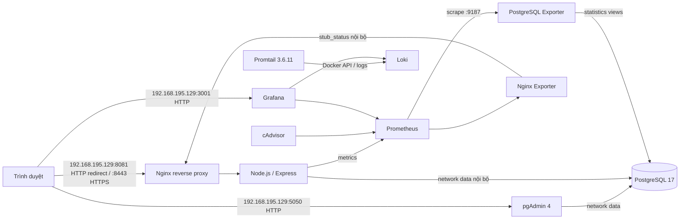

# BÁO CÁO TRIỂN KHAI

## Trang bìa

**Trường:** ..............................................................................

**Khoa:** ................................................................................

**Đề tài:** Quản lý chi tiêu cá nhân

**Sinh viên:** ..........................................................................

**Mã số sinh viên:** .................................................................

**Lớp/Khóa:** ..........................................................................
**Năm học:** ...........................................................................

> Ảnh rubric Owner cung cấp ghi tối đa 10 trang. Sau đó Owner xác nhận dùng bản 18 trang A4 cho báo cáo này. Ở lượt trước, bản Word đầu ra được mở chỉ đọc bằng Microsoft Word, báo 18 trang và được rà soát bố cục. Tệp nguồn có hậu tố `(2)` không tồn tại; bản nguồn đính kèm không có hậu tố đã được dùng. Trong lần kiểm tra Git ngày 23/10/2026, đường dẫn đầu ra dự kiến trong Downloads không còn tệp, nên khả năng truy cập bản bàn giao hiện tại chưa xác minh. Tài liệu Word không được đưa vào repository. Kết quả runtime do Owner cung cấp được phân biệt với kiểm tra cục bộ và nội dung chưa xác minh.

## Chương 1. Tổng quan kiến trúc hệ thống

### 1.1. Mục tiêu và thành phần

Ứng dụng cung cấp đăng ký/đăng nhập, quản lý thu nhập và chi tiêu, quản lý danh mục, lọc theo tháng và tổng quan tài chính bằng giao diện tiếng Việt. Mỗi tài khoản chỉ truy cập dữ liệu có `user_id` khớp với phiên đăng nhập.



Compose tạo các network riêng: `edge` dạng bridge cho Nginx, pgAdmin, Grafana và Prometheus; `data` cho PostgreSQL, ứng dụng, pgAdmin và PostgreSQL Exporter; `proxy` cho Nginx/ứng dụng/Nginx Exporter; `metrics` nội bộ (`internal: true`) cho ứng dụng, hai exporter, cAdvisor, Prometheus và Grafana; `logs` nội bộ cho Promtail, Loki và Grafana. Prometheus publish `192.168.195.129:9091` tới cổng container `9090` qua `edge`, đồng thời vẫn tham gia `metrics`; PostgreSQL và exporters không publish cổng host. Network `data` của database giữ nguyên. Cấu hình nguồn hiện tại publish Nginx, pgAdmin, Grafana và Prometheus trên IP VM `192.168.195.129`. Owner báo đã triển khai thay đổi IP lên VM; snapshot loopback cũ được giữ làm lịch sử. Do SSH không kết nối được trong lượt này, Agent chưa đối chiếu file live/checksum và chưa xác nhận cấu hình nguồn khớp runtime.

### 1.2. Quản lý mã nguồn

Tại preflight trước lần đồng bộ ngày 23/10/2026, nhánh là `feature/expense-tracker-full-stack`, `HEAD` là `d2f9f323b8ad3d599075b71b63a79a4d5491278a`; worktree có thay đổi ở `.env.example`, `README.md`, báo cáo này, `infra/compose.yaml`, `infra/nginx/default.conf` và các file Word/thư mục QA chưa theo dõi. Lần `git fetch origin` đầu tiên bị chặn khi mở `.git/FETCH_HEAD`; fetch có quyền mạng đầy đủ sau đó cập nhật `origin/main` lên `9cbf6df9bf4995bdc0bd4e3867068b508f329697`. Kiểm tra GitHub xác nhận `origin/develop` ở `b79736758d87283934222edd4a01e76904268d42`, PR #1 đã merge vào `main` từ feature commit `d2f9f323b8ad3d599075b71b63a79a4d5491278a`, và remote hiện không có ref feature. Trước khi tạo commit đồng bộ, local feature có 1 commit riêng so với `develop`; remote `main`/`develop` không được sửa. Đây là snapshot pre-sync, không chứng minh runtime VM đã đồng bộ.

**[CẦN KIỂM CHỨNG]** Hình minh chứng 1: chụp màn hình `git status --short --branch`, nhánh và lịch sử sau khi hoàn tất nghiệm thu. Bước chụp: chạy các lệnh Git ở cuối báo cáo trong thư mục repository.

### 1.3. Chia phần Người 1 và Người 2

- Người 1: `package.json`, `src/`, `public/`, `test/`.
- Người 2: `Dockerfile`, `.dockerignore`, `.env.example`, `.gitignore`, toàn bộ `infra/`.
- Tài liệu phối hợp: `README.md` và báo cáo này.

`infra/compose.yaml` dùng build context `..`, nên có thể chạy Compose từ repository hiện tại và build mã ứng dụng ở thư mục gốc. Chưa có file nào được chuyển sang repository nhóm.

## Chương 2. Triển khai ứng dụng, CSDL, Nginx và HTTPS

### 2.1. Công nghệ và phiên bản

| Thành phần | Phiên bản/cách dùng |
|---|---|
| Node.js | 24.21.0 trong Dockerfile; nhánh 24 LTS |
| Express | 5.1.0 |
| PostgreSQL | image `postgres:17.11-alpine` |
| pgAdmin | image `dpage/pgadmin4:9.18` |
| Nginx | image `nginx:1.30.6-alpine` |
| PostgreSQL Exporter | image `quay.io/prometheuscommunity/postgres-exporter:v0.20.1` |
| Phiên cookie | express-session, lưu trong PostgreSQL qua connect-pg-simple |
| Mật khẩu | bcryptjs 3.0.2, cost 12 |
| Metrics ứng dụng | `@prometheus-io/client` 0.16.0 |

**[CẦN KIỂM CHỨNG]** Phiên bản image/runtime chưa được agent kiểm tra độc lập bằng Docker trong môi trường Windows. Sau khi có Docker, có thể kiểm tra bằng `docker compose ... exec app node --version` và `docker compose ... exec db sh -lc 'psql -U "$POSTGRES_USER" -d "$POSTGRES_DB" -c "SELECT version();"'`. Bằng chứng Owner về runtime Grafana/ứng dụng được ghi riêng tại mục 4.2.

### 2.2. Ứng dụng và cơ sở dữ liệu

Schema ở `src/db/schema.sql` định nghĩa `users`, `categories`, `transactions` với UUID, khóa ngoại, unique/check constraints và index cho email, danh mục, chủ sở hữu và ngày giao dịch. Khóa ngoại ghép `(category_id, user_id, type)` bảo đảm giao dịch chỉ gắn với danh mục cùng chủ sở hữu và cùng loại.

API giao dịch/danh mục dùng câu lệnh tham số. Các thao tác sửa/xóa theo ID lọc đồng thời bằng `user_id` của session. Session ID được thay sau đăng nhập/đăng ký; cookie `HttpOnly`, `SameSite=Strict`, `Secure` trong Compose. Request thay đổi dữ liệu phải có CSRF token và cùng Origin. Login bị giới hạn 10 lần/15 phút/IP; đăng ký 5 lần/giờ/IP.

#### Nghiệm thu thủ công do Owner cung cấp (minh chứng ứng dụng 2–3)

- Ảnh/kết quả Owner cung cấp cho thấy tổng thu `100.000đ`, tổng chi `20.000đ`, số dư `80.000đ`; giao dịch chi “Giải trí” `20.000đ` xuất hiện trong danh sách và khoản thu “Thưởng” `100.000đ` vẫn còn.
- Owner đã thêm và sửa giao dịch. Khi sửa giao dịch chi thành `30.000đ`, tổng chi hiển thị `30.000đ` và số dư `70.000đ`; sau khi sửa lại thành `20.000đ`, tổng chi trở về `20.000đ` và số dư `80.000đ`.
- Owner tải lại trang và đăng xuất/đăng nhập lại; giao dịch cùng số liệu vẫn còn.
- Bằng chứng xác nhận các luồng xem, thêm, sửa và lưu bền qua tải lại/đăng nhập lại. Ảnh dashboard/giao dịch trong bản Word riêng do Owner cung cấp được ghi nhận là bằng chứng tại thời điểm chụp, không phải runtime mới do agent tái kiểm tra; ảnh không được nhúng vào Markdown/repository. Chưa có bằng chứng thao tác xóa giao dịch, CRUD danh mục, kiểm thử cô lập dữ liệu giữa hai tài khoản hoặc toàn bộ kiểm thử tích hợp.

### 2.3. Docker Compose và lưu trữ

Stack mặc định chạy ứng dụng, PostgreSQL, pgAdmin, Nginx, Prometheus, Grafana, Loki, Promtail, PostgreSQL Exporter, Nginx Exporter và cAdvisor. PostgreSQL chỉ ở network `data` nội bộ, không khai báo `ports`. Trong cấu hình nguồn, pgAdmin publish `${VM_HOST_IP}:5050:80`, Grafana `${VM_HOST_IP}:3001:3000`, còn Prometheus publish `192.168.195.129:9091:9090`; ba giao diện tham gia `edge`. Prometheus đồng thời tham gia `metrics` có `internal: true`. PostgreSQL và exporters không publish cổng host, và network `data` không thay đổi. Nginx publish `${VM_HOST_IP}:${NGINX_HTTP_PORT}:80` và `${VM_HOST_IP}:8443:443`. Mặc định `VM_HOST_IP` là `192.168.195.129`; Owner báo VM dùng `NGINX_HTTP_PORT=8081`. Owner cũng báo thay đổi IP đã được triển khai; do Agent không thể SSH nên chưa đối chiếu checksum cấu hình live với nguồn. PostgreSQL Exporter nối vào `data` để đọc metrics và `metrics` để Prometheus scrape `postgres-exporter:9187`; exporter không publish cổng host. `postgres_data`, `pgadmin_data`, `prometheus_data`, `grafana_data`, `loki_data`, `promtail_positions`, `alloy_data` và `nginx_certs` là named volume; trạng thái positions giúp Promtail tiếp tục đọc sau khi restart. Service Alloy được giữ dưới profile `legacy-alloy`, không hoạt động mặc định; chỉ dùng lệnh `stop` trên container cũ, tuyệt đối không chạy profile này cùng Promtail. `docker compose down` không xóa volume; không dùng `down -v` khi muốn giữ dữ liệu.

pgAdmin đăng nhập bằng `PGADMIN_DEFAULT_EMAIL`/`PGADMIN_DEFAULT_PASSWORD`. Khi đăng ký server, đặt host `db`, port `5432`, maintenance database `DB_NAME`, username `DB_USER` và password `DB_PASSWORD`. Các biến này đều lấy từ `.env`; không lưu secret trong repository.

PostgreSQL Exporter `v0.20.1` được kiểm thử chính thức với PostgreSQL 13–18. Job `postgres-exporter-init` dùng tài khoản quản trị hiện có để tạo hoặc cập nhật role riêng `POSTGRES_EXPORTER_USER`, đặt role `NOSUPERUSER NOCREATEDB NOCREATEROLE NOREPLICATION NOBYPASSRLS`, cấp `CONNECT` trên database cấu hình và role dựng sẵn `pg_monitor`. Nó chỉ thay đổi metadata role/quyền, không chạy migration và không sửa schema, bảng hay dữ liệu. Exporter nhận riêng `POSTGRES_EXPORTER_USER`/`POSTGRES_EXPORTER_PASSWORD`. Tài khoản quản trị DB chỉ có trong init container; người có quyền `docker inspect` có thể xem environment. Role metrics được đặt lại theo password từ `.env` mỗi khi init job chạy; tên role phải dành riêng cho exporter.

Ứng dụng chạy bằng user `node` (UID không phải root). PostgreSQL có healthcheck `pg_isready`; app healthcheck gọi `/health/ready`, Nginx gọi endpoint readiness qua HTTPS nội bộ, Grafana có healthcheck HTTP. Loki không khai báo healthcheck vì image không có `/bin/sh`; readiness Loki được kiểm tra riêng qua `/ready` bằng container curl trên network `logs`.

### 2.4. Reverse proxy và HTTPS

Nginx nhận HTTP trong container ở cổng 80; host port cấu hình bằng `NGINX_HTTP_PORT`, mặc định `8080`, Owner báo VM dùng `8081` vì cổng 8080 đã có dịch vụ. Cấu hình nguồn bind các cổng web vào `VM_HOST_IP` (mặc định IP VM `192.168.195.129`); Nginx chuyển HTTP sang HTTPS trên cổng 8443 rồi proxy tới Express. `cert-init` tạo RSA self-signed cert có subjectAltName kiểu IP cho `VM_HOST_IP`; nếu chứng chỉ trong named volume không chứa IP cấu hình, job sẽ tạo chứng chỉ mới khi được chạy lại. Owner báo đã triển khai và kiểm tra SAN; Agent chưa xác minh file/certificate runtime. Chứng chỉ vẫn tự ký, nên trình duyệt chưa tin cậy CA.

Nginx và Helmet đặt `X-Frame-Options: SAMEORIGIN`, `X-Content-Type-Options: nosniff`, CSP và Referrer-Policy. Không thêm `X-XSS-Protection` vì đây là header legacy và không thay thế CSP. `/metrics` và các đường dẫn `/health/` khác bị chặn; ngoại lệ chính xác `/health/ready` chỉ cho client loopback `127.0.0.1` rồi proxy tới app để Nginx healthcheck hoạt động. Nginx `stub_status` chỉ nghe cổng nội bộ 8081.

Owner cung cấp kết quả kiểm tra thủ công trên cấu hình loopback cũ: HTTP qua Nginx trả `308` chuyển hướng sang HTTPS; HTTPS trả `HTTP/2 200` khi kiểm tra bằng `curl -k`. Security headers được trả về, nhưng output có một số header trùng lặp; chưa có bằng chứng đã sửa. Do dùng `curl -k`, kết quả không xác nhận chứng chỉ self-signed được hệ điều hành/trình duyệt tin cậy; truy cập Internet công cộng cũng chưa được kiểm tra. Ở lần triển khai IP mới, Owner báo đã chạy `nginx -t` thành công, `cert-init` exit 0 và kiểm tra chứng chỉ có SAN `192.168.195.129`; Nginx healthy trên IP VM. Agent chưa kết nối được SSH nên không tái kiểm tra các lệnh/kết quả này.

Ảnh chụp lệnh HTTP/HTTPS đã được đưa vào bản Word riêng với phần nhận dạng máy chủ/tài khoản được loại bỏ; đây là kết quả Owner cung cấp tại thời điểm chụp, agent không tái chạy. Các lệnh dưới đây kiểm tra trực tiếp địa chỉ VM từ máy client:

```powershell
curl.exe -I http://192.168.195.129:8081
curl.exe -k -I https://192.168.195.129:8443
```

Từ Ubuntu VM hoặc máy client có route tới VM (Linux shell):

```bash
curl -I http://192.168.195.129:8081
curl -k -I https://192.168.195.129:8443
```

Các lệnh trên chỉ là hướng dẫn tái hiện; agent không chạy chúng trong lượt cập nhật này. Ảnh chưa được nhúng vào Markdown/repository.

### 2.5. pgAdmin

pgAdmin 4 `9.18` chạy trên image `dpage/pgadmin4:9.18`, cấu hình nguồn publish `192.168.195.129:5050` và lưu cấu hình vào named volume `pgadmin_data`. Container tham gia network `data` để nối PostgreSQL và `edge` để publish giao diện; PostgreSQL không publish cổng host. Đăng nhập giao diện bằng `PGADMIN_DEFAULT_EMAIL`/`PGADMIN_DEFAULT_PASSWORD`; sau đó thêm server với host `db`, port `5432`, maintenance database `DB_NAME`, username `DB_USER` và password `DB_PASSWORD`. pgAdmin 9.18 hỗ trợ PostgreSQL 17 theo tài liệu container chính thức.

Owner báo đã sửa lỗi gõ nhầm IP trong quá trình chuyển pgAdmin sang `192.168.195.129:5050`. Ảnh ngày 23/10/2026 cho thấy trình duyệt mở giao diện, database `chi_tieu` và schema `public`; ảnh Docker cùng ngày cho thấy pgAdmin `Up` và cổng bind IP VM. Đây là PASS cho khả năng truy cập giao diện tại thời điểm chụp, do Owner cung cấp, chưa được Agent tái kiểm tra. Ảnh không chứng minh mọi thao tác quản trị hoặc backup/restore. Trong pgAdmin, PostgreSQL vẫn được đăng ký bằng host `db:5432`; cổng database không mở ra host.

Owner từng xác nhận endpoint pgAdmin trả HTTP 302 và cổng `5050` chỉ bind loopback trong cấu hình cũ; các ảnh đó là bằng chứng lịch sử. Ảnh mới do Owner cung cấp cho thấy pgAdmin mở trực tiếp qua IP VM và Docker ghi nhận mapping `192.168.195.129:5050` tại thời điểm chụp. Agent chưa kiểm tra độc lập độ ổn định, endpoint HTTP hoặc firewall.

Bản Word giữ ảnh pgAdmin lịch sử qua SSH tunnel và thêm ảnh Owner cung cấp ngày 23/10/2026 về giao diện qua IP VM. Ảnh mới ghi nhận database/schema đang hiển thị nhưng không chứng minh backup/restore hay toàn bộ CRUD. Không đưa tên tài khoản SSH hoặc mật khẩu vào tài liệu chia sẻ; ảnh giao diện có thông tin định danh hiển thị và cần Owner cân nhắc trước khi chia sẻ rộng.

## Chương 3. Prometheus, Grafana, Loki/Promtail và LogQL

### 3.1. Thu thập metrics

Job init PostgreSQL Exporter chạy sau healthcheck DB, tạo role metrics tối thiểu và kết thúc thành công trước khi exporter khởi động. Prometheus scrape ứng dụng (`/metrics`), Nginx Exporter (`stub_status`), PostgreSQL Exporter (`postgres-exporter:9187`), cAdvisor và chính Prometheus mỗi 15 giây. Dashboard provisioned có panel `pg_up`, transaction commit/rollback mỗi giây, deadlocks mỗi phút và kích thước database, cùng request rate, HTTP p95, trạng thái target, CPU, RAM và Network I/O của container. Các metric PostgreSQL đến từ statistics views của chính PostgreSQL; datasource Prometheus và dashboard Grafana được provision từ file trong `infra/grafana/`. Giao diện Prometheus/API được cấu hình truy cập tại [http://192.168.195.129:9091](http://192.168.195.129:9091), host port `9091` ánh xạ tới container port `9090`.

Image đã pin trong Compose: Prometheus 3.14.0, Grafana 13.2.2, Loki 3.6.11, Promtail 3.6.11, PostgreSQL Exporter 0.20.1, pgAdmin 9.18, Nginx Exporter 1.4.2, cAdvisor 0.60.6. Loki dùng filesystem TSDB local, retention 7 ngày và volume riêng. Loki và Promtail dùng tag cùng phiên bản 3.6.11 từ release/image do Grafana phát hành; cấu hình Promtail được viết theo reference gắn với tag Loki 3.6.11. Đây là pin phục vụ demo, không thay đổi tình trạng hỗ trợ của Promtail. PostgreSQL Exporter công bố CI cho PostgreSQL 17; pgAdmin 9.18 hỗ trợ PostgreSQL 17. Tham chiếu: [Exporter release v0.20.1](https://github.com/prometheus-community/postgres_exporter/releases/tag/v0.20.1), [Exporter Docker image/flags](https://github.com/prometheus-community/postgres_exporter/blob/master/docs/docker.md), [Exporter quyền database](https://github.com/prometheus-community/postgres_exporter/blob/master/docs/database-permissions.md), [pgAdmin container deployment 9.18](https://www.pgadmin.org/docs/pgadmin4/9.18/container_deployment.html).

Ảnh dashboard Grafana do Owner cung cấp cho thấy target scrape PostgreSQL Exporter có giá trị `1`, panel `pg_up` hiển thị `1`, và các panel transaction commit/rollback, deadlocks, cùng kích thước database được hiển thị tại thời điểm chụp. Đây là bằng chứng giao diện do Owner cung cấp, không phải agent chạy lại; nội dung biểu thức PromQL và độ chính xác của từng series chưa được kiểm tra độc lập.

PostgreSQL và exporters không publish port ra host. Prometheus publish giao diện/API tại `192.168.195.129:9091` qua `edge`, đồng thời vẫn tham gia `metrics` nội bộ; cấu hình mạng `data` của database không đổi. Ảnh Prometheus do Owner cung cấp cho thấy truy vấn PromQL `up` trả 5 series đều bằng `1` (`expense-app`, `postgres`, `nginx`, `containers`, `prometheus`) và trang Target health ghi nhận 5/5 UP. Đây là bằng chứng về khả năng scrape tại thời điểm chụp, không chứng minh uptime liên tục hoặc tính chính xác của mọi metric/query.

Ảnh hai phần dashboard PostgreSQL được đưa vào bản Word riêng: panel kết nối exporter/`pg_up`, commit/rollback, deadlocks và kích thước database. Ảnh chứng minh các panel có nội dung tại thời điểm chụp; ảnh Prometheus mới bổ sung xác nhận truy vấn `up` và trạng thái scrape targets, nhưng không thay thế việc đối chiếu từng truy vấn metrics với dữ liệu PostgreSQL.

### 3.2. Thu thập log và vòng đời Promtail

Không tìm thấy file rubric gốc trong repository; ảnh rubric Owner cung cấp yêu cầu Loki + Promtail. Stack mặc định dùng `grafana/loki:3.6.11` và `grafana/promtail:3.6.11`. Grafana công bố Promtail EOL từ 02/03/2026, không còn hỗ trợ hay cập nhật; chỉ dùng cho demo học tập theo rubric, không phải lựa chọn được hỗ trợ hoặc khuyến nghị cho production.

Tham chiếu đã tra cứu: [Loki v3.6.11 release](https://github.com/grafana/loki/releases/tag/v3.6.11), [Promtail image tags do Grafana Labs phát hành](https://hub.docker.com/r/grafana/promtail/tags), [Promtail config reference ở tag v3.6.11](https://github.com/grafana/loki/blob/v3.6.11/docs/sources/send-data/promtail/configuration.md) và [thông báo EOL chính thức](https://grafana.com/docs/loki/latest/send-data/promtail/).

Promtail dùng `docker_sd_configs` với Docker socket `/var/run/docker.sock`, discovery refresh 10 giây, lọc project `${PROMTAIL_COMPOSE_PROJECT}` và các service `app`, `nginx`, `db`. Compose bật `-config.expand-env=true` để Promtail thay biến bằng giá trị truyền qua environment; giá trị mặc định `chi-tieu-ca-nhan` khớp `name:` trong Compose. Docker service discovery yêu cầu container dùng logging driver `json-file` hoặc `journald`; cấu hình Compose hiện không thay logging driver mặc định. Promtail gắn nhãn ổn định `job="docker"`, `compose_service` (ba giá trị cố định `app`, `nginx`, `db`) và `level` chỉ cho log JSON của ứng dụng (hiện `info`/`error`). Không đưa log content, request ID, container ID hoặc đường dẫn động vào label. Pipeline duy nhất chạy mặc định là Promtail; Alloy config cũ được giữ trong `infra/alloy/config.alloy`, còn service Alloy chỉ nằm trong profile `legacy-alloy` để có thể dừng container cũ mà không xóa volume. Không chạy lệnh `up` với profile này. Tham chiếu env expansion: [Grafana Loki configuration parameters](https://grafana.com/docs/loki/latest/configure/).

Owner xác nhận bản VM hiện chạy project `expense-tracker-demo` và Promtail của VM đã được chỉnh để lọc tên đó. Owner cũng từng xác nhận các biến môi trường bổ sung cho pgAdmin, PostgreSQL Exporter, HTTP port và project label đã được thêm vào `.env` hiện có; báo cáo không chứa giá trị của chúng. Khi cập nhật VM sau này, giữ nguyên project identity bằng `docker compose --project-name expense-tracker-demo ...`; không đổi `name:` trong repository hoặc project name trên VM một cách độc lập vì Compose dùng project name làm prefix cho named volume và có thể khởi tạo volume DB khác. Không đọc hay sao chép `.env` VM trong lượt cập nhật báo cáo này.

Luồng log: stdout/stderr của app và Nginx (cùng db để hỗ trợ debug) → Docker API qua socket → Promtail → `http://loki:3100/loki/api/v1/push` qua network `logs` nội bộ → Grafana datasource Loki. Socket được bind `:ro`, nhưng chế độ mount chỉ đọc không giới hạn các API call gửi qua socket; quyền này nhạy cảm trên Docker host. Cấu hình dùng Linux containers và không bind mount đường dẫn log của host, để giảm phụ thuộc đường dẫn trên Docker Desktop; khả năng socket hoạt động trên Windows Docker Desktop vẫn cần runtime xác nhận.

Loki không có shell trong image nên healthcheck `CMD-SHELL` không dùng được. Cấu hình nguồn bỏ healthcheck đó; Promtail chỉ phụ thuộc `loki: service_started`, điều này không khẳng định Loki đã sẵn sàng. Có thể kiểm tra `/ready` riêng từ một container curl tham gia network `logs`. Với project VM hiện có, lệnh Linux là `docker run --rm --network expense-tracker-demo_logs curlimages/curl:8.12.1 --fail --show-error http://loki:3100/ready`. Image curl được pin ở tag `8.12.1` ([repository chính thức curl-container](https://github.com/curl/curl-container)). Theo kết quả Owner cung cấp, Loki `/ready` đã trả `HTTP/1.1 200 OK` với body `ready` tại thời điểm kiểm tra; agent không chạy lại lệnh này trong lượt cập nhật báo cáo.

Trong snapshot runtime loopback cũ do Owner cung cấp, Grafana healthy bên trong container; Docker publish `127.0.0.1:3001 -> 3000` và `http://127.0.0.1:3001/api/health` trả HTTP 200. Owner hiện báo Grafana healthy sau khi chuyển sang IP VM; chưa có bằng chứng Agent truy vấn API hoặc đối chiếu PortBindings mới. Ảnh dashboard Owner cung cấp cho thấy request rate, HTTP p95 latency, scrape target, CPU, RAM, logs và các panel PostgreSQL có dữ liệu tại thời điểm chụp. Bằng chứng ảnh cũ không xác nhận mọi target healthy sau lần triển khai cuối hoặc khả năng truy cập từ Internet công cộng. Ảnh được dùng trong bản Word riêng nhưng chưa đưa vào repository/Markdown.

### 3.3. Truy vấn LogQL mẫu

Ba ảnh Grafana Explore trong bản Word do Owner cung cấp thể hiện các truy vấn sau đã trả về dữ liệu tại thời điểm chụp 21/10/2026. Agent không chạy lại các query; kết quả chỉ xác nhận ảnh chụp, không bảo đảm trạng thái Loki hiện thời.

```logql
# [PASS theo ảnh Owner] Log ứng dụng; Explore hiển thị 88 dòng
{compose_service="app"}

# [PASS theo ảnh Owner] Log Nginx; Explore hiển thị 135 dòng
{compose_service="nginx"}

# [PASS theo ảnh Owner] Lọc readiness; kết quả có GET /health/ready với status 200
{compose_service="app", level="info"} |= "health/ready"
```

Các bộ lọc riêng cho HTTP 5xx, ứng dụng `level="error"` và thống kê tổng hợp số log vẫn `[CẦN KIỂM CHỨNG]`; chúng không nằm trong ba ảnh nêu trên.

## Chương 4. Hardening, đánh giá bảo mật và kết luận

### 4.1. Hardening đã cấu hình

- Không có vai trò admin trong ứng dụng; Grafana admin riêng cho công cụ monitoring.
- Mật khẩu băm bcrypt; session lưu phía server trong PostgreSQL, ID rotate sau đăng nhập/đăng ký.
- CSRF token ngẫu nhiên, kiểm tra Origin, cookie `HttpOnly`/`SameSite=Strict`/`Secure` khi chạy Compose.
- SQL dùng bind parameters; validation có giới hạn độ dài, kiểu, ngày lịch và số tiền.
- Mọi truy vấn theo ID đều kiểm tra `user_id`; FK ghép chống gắn chéo chủ sở hữu.
- Nginx ẩn version, giới hạn body, CSP và security headers; cổng DB không publish ra host.
- Candidate source bind pgAdmin vào IP cụ thể `192.168.195.129:5050`; PostgreSQL Exporter chỉ nghe trên network nội bộ và không publish port. Việc mở giao diện quản trị trên interface VM làm tăng phạm vi máy có thể kết nối; chỉ dùng mạng tin cậy và giữ xác thực mạnh.
- Secret được đọc từ `.env`; `.gitignore` bỏ qua `.env` và cho phép giữ `.env.example` không chứa secret thật.

### 4.2. Giới hạn và rủi ro cần nghiệm thu

- Self-signed HTTPS chỉ phù hợp demo. Cấu hình nguồn bind vào IP VM để truy cập trong mạng có route. Owner báo iptables giới hạn Grafana/pgAdmin cho máy Windows, nhưng Agent chưa xem rule hoặc xác minh từ client; không xác nhận truy cập Internet công cộng và không tự thay firewall của host.
- cAdvisor dùng `privileged` và đọc các mount hệ thống để có số liệu container. Promtail cần Docker socket để discovery và đọc stream log; mount `:ro` không hạn chế quyền của Docker API. Chỉ chạy trong môi trường demo tin cậy và không mở endpoint agent ra host.
- Init job cần `DB_USER`/`DB_PASSWORD` superuser hiện có để provision role metrics. Người có quyền đọc environment của Docker container có thể xem credential đó. Exporter chạy sau đó bằng role riêng `pg_monitor` không phải superuser. Owner từng xác nhận exporter có metrics và target Prometheus hoạt động; quyền cụ thể của role/init SQL chưa được agent kiểm tra độc lập trong lượt cập nhật báo cáo này.

#### Bằng chứng runtime và nghiệm thu thủ công do Owner cung cấp

- Snapshot `docker compose ... ps -a` cũ do Owner cung cấp ghi nhận `app`, `db`, `nginx`, `grafana`, `promtail`, `cadvisor` Up/healthy; `loki`, `prometheus`, `nginx-exporter`, `pgadmin`, `postgres-exporter` Up; `cert-init` và `postgres-exporter-init` Exited (0). Cùng snapshot ghi port Grafana/Nginx/pgAdmin bind loopback. Đây là trạng thái lịch sử trước lần đổi IP, không đại diện trạng thái mới.
- Owner báo trên VM đã sửa Compose để bind Nginx HTTP/HTTPS `192.168.195.129:8081`/`:8443`, Grafana `:3001`, pgAdmin `:5050`; cập nhật `server_name`, Grafana root URL và chứng chỉ self-signed có SAN IP. Owner báo `config --quiet`, `nginx -t`, `cert-init` exit 0 và kiểm tra SAN đạt. Ảnh Owner ngày 23/10/2026 cho thấy Docker mapping các cổng trên IP VM; app, DB, Nginx, Grafana, Promtail và cAdvisor `Up (healthy)`, các service còn lại trong ảnh `Up`. Ảnh curl cho thấy HTTPS `200` với `-k` và HTTP `308`; ảnh Grafana có panel dữ liệu; ảnh pgAdmin mở database `chi_tieu`. Đây là bằng chứng Owner cung cấp, Agent chưa tái hiện.
- Owner báo SSH cổng 22 từ Windows kết nối được và iptables giới hạn cổng Grafana/pgAdmin cho máy Windows trong VMware VMnet8. Agent không xem rule firewall, không thử kết nối từ client và không thay đổi firewall. PostgreSQL cùng các cổng monitoring nội bộ không được yêu cầu publish ra host.
- Sự cố pgAdmin do gõ nhầm IP `192.169.195.129` được Owner báo đã sửa. Ảnh ngày 23/10/2026 cho thấy container `Up`, port `5050` bind `192.168.195.129` và giao diện mở database/schema. Điều này PASS ở mức giao diện có thể truy cập tại thời điểm chụp; Agent chưa kiểm tra độc lập, ổn định dài hạn, mọi thao tác CRUD hoặc backup/restore.
- Từ môi trường Agent, lệnh SSH qua Windows OpenSSH Agent trả `Permission denied` (exit 255). Lần `git fetch origin` đầu cũng thất bại vì không mở được `.git/FETCH_HEAD`, nhưng một lần fetch sau với quyền mạng phù hợp đã thành công và cập nhật remote refs; việc này không xác minh cấu hình VM. Checksum source/staging/live, config live, trạng thái dịch vụ mới nhất, rule firewall và pgAdmin vẫn chưa được Agent kiểm tra độc lập.
- Ảnh curl Owner cung cấp ngày 23/10/2026 cho thấy HTTP trên `192.168.195.129:8081` trả `308` tới HTTPS `:8443`, còn HTTPS trả `200` khi dùng `curl -k`. Vì `-k` bỏ qua xác thực CA nên không xác nhận chứng chỉ được tin cậy. Security headers từng có một số header trùng; chưa có bằng chứng sửa hoặc ảnh kiểm tra mới.
- Owner cung cấp kết quả Loki `/ready` là `HTTP/1.1 200 OK`, body `ready`, tại thời điểm kiểm tra. Trước đó Loki từng trả `503`; kết quả mới xác nhận readiness ở lần kiểm tra này nhưng không chứng minh trạng thái liên tục.
- Owner báo ở lần triển khai IP mới Grafana healthy và API health trả HTTP 200. Ảnh ngày 23/10/2026 cho thấy giao diện qua `192.168.195.129:3001` và panel request rate, HTTP p95, scrape targets, CPU/RAM, Network I/O và logs có dữ liệu. Ảnh không chứng minh mọi target luôn UP, độ ổn định dài hạn hoặc biểu thức từng query chính xác.
- Ảnh Docker và pgAdmin ngày 23/10/2026 cho thấy pgAdmin `Up`, bind `192.168.195.129:5050`, giao diện mở database `chi_tieu`/schema `public`. Bằng chứng này thay thế trạng thái “chưa có ảnh sau sửa IP” nhưng không chứng minh backup/restore hoặc toàn bộ CRUD. PostgreSQL Exporter trước đó do Owner xác nhận có `pg_up=1`, target Prometheus `postgres` trả `1`; ảnh Docker mới chỉ cho thấy exporter `Up`.
- Owner xác nhận ứng dụng hiển thị tổng thu `100.000đ`, tổng chi `20.000đ`, số dư `80.000đ`; giao dịch “Giải trí” `20.000đ` và khoản thu “Thưởng” `100.000đ` còn trong danh sách. Khi sửa khoản chi thành `30.000đ`, tổng chi/số dư đổi thành `30.000đ`/`70.000đ`; sửa về `20.000đ` thì số liệu trở lại `20.000đ`/`80.000đ`. Tải lại trang và đăng xuất/đăng nhập lại không làm mất giao dịch.
- Owner trước đây xác nhận sau khi restart riêng DB, ứng dụng vẫn healthy, giao dịch thử `100.000 ₫` còn nguyên và PostgreSQL dùng volume `expense-tracker-demo_postgres_data`.

Đây là kết quả runtime/thao tác thủ công theo ảnh, output và thông tin Owner cung cấp; Agent không truy cập VM hoặc tự lặp lại các thao tác. Ảnh trước đó được giữ trong báo cáo Word; bốn ảnh Owner gửi ngày 23/10 được đặt cạnh nội dung tương ứng. Các bằng chứng này ghi nhận trạng thái ở thời điểm chụp, không xác nhận uptime hoặc trạng thái sau đó. Ảnh không được thêm riêng vào repository ngoài tệp Word đầu ra chưa stage.

#### Các mục vẫn chưa được xác minh

- Loki từng được Owner báo trả 503; lần kiểm tra Owner mới nhất cho thấy `/ready` trả 200 với body `ready`. Đây là kết quả tại thời điểm kiểm tra, không phải cam kết readiness liên tục. Ba ảnh Explore chứng minh ba query đã có dữ liệu tại thời điểm chụp. Các query lọc HTTP 5xx, lỗi app và thống kê tổng hợp chưa được chụp/kiểm tra. API labels trước đó trả `success` theo kết quả Owner cung cấp.
- Ảnh dashboard Owner cung cấp hiển thị panel PostgreSQL exporter/`pg_up`, commit/rollback, deadlocks và kích thước DB. Chưa có ảnh Explore hoặc phép đối chiếu độc lập để xác minh biểu thức PromQL và tính chính xác từng giá trị.
- Snapshot service cũ và báo cáo trạng thái IP mới đều chỉ mô tả thời điểm Owner kiểm tra; chưa có bằng chứng về trạng thái liên tục. Chưa kiểm tra cổng từ Internet công cộng, xóa giao dịch/danh mục, toàn bộ luồng CRUD hoặc cô lập dữ liệu giữa nhiều tài khoản.
- HTTPS dùng chứng chỉ self-signed chỉ phù hợp demo/local. `curl -k` bỏ qua xác thực chứng chỉ nên chưa chứng minh chứng chỉ CA tin cậy; truy cập Internet công cộng cũng chưa được kiểm tra.
- Promtail đã EOL từ 02/03/2026; được giữ riêng cho demo học tập do không tìm thấy rubric và mẫu báo cáo có Promtail. Không triển khai Promtail này cho production; Alloy là cấu hình lưu trữ nhưng không hoạt động trong stack mặc định.
- Docker CLI/Nginx CLI không có trong PATH Windows. SSH qua Agent bị từ chối nên Agent không kiểm tra runtime mới. Header trùng lặp đã được quan sát ở snapshot cũ nhưng chưa sửa; cấu hình Nginx và phạm vi test đang chờ phê duyệt riêng. Docker socket trên Docker Desktop, các query chưa có ảnh và phép đối chiếu PromQL vẫn cần nghiệm thu.
- Test HTTP dùng PostgreSQL pool giả; cần chạy thêm tích hợp với PostgreSQL thật để xác nhận schema, session store, cascade/restrict và truy vấn tổng hợp.

### 4.3. Kết luận và hướng phát triển

Mã nguồn ứng dụng và cấu hình hạ tầng đã được tổ chức trong repository cá nhân, có ranh giới rõ giữa `src/`/`public/` và `infra/`. Sau khi chạy kiểm thử Docker, hướng tiếp theo là thay chứng chỉ bằng CA/TLS thật nếu triển khai, quản lý secret ngoài file `.env`, sao lưu/khôi phục volume có quy trình, thêm kiểm thử tích hợp PostgreSQL và cập nhật monitoring theo rubric chính thức.

### 4.4. Kiểm tra tự động, runtime và thủ công

#### Kiểm tra tự động/cục bộ trong Gate B

- `npm.cmd run lint`: exit 0; `node --check` cho server, validation, giao diện và test.
- `npm.cmd test`: lần chạy sandbox exit 1 (1/2 test đạt) do `EACCES` khi kết nối loopback. Chạy lại với quyền mạng loopback cục bộ exit 0 (2/2 test đạt). Test dùng PostgreSQL pool/session store giả; không xác nhận tích hợp PostgreSQL thật.
- `npm audit --omit=dev --audit-level=high`: lần kiểm tra trước trong Gate B ghi nhận `found 0 vulnerabilities`; các lần chạy lại ngày 21/10 và 23/10/2026 không truy cập được registry do DNS `ENOTFOUND registry.npmjs.org`, nên advisory hiện hành chưa được xác minh lại.
- Ngày 23/10/2026, PyYAML parse thành công 6 file YAML và JSON parser parse thành công 1 file JSON trong `infra/`; kiểm tra cú pháp không chứng minh runtime.
- Docker CLI không có trong PATH; không chạy Docker Compose hoặc truy cập VM. Ở lượt trước, Microsoft Word báo 18 trang và các trang của bản Word đầu ra được rà soát; đường dẫn đầu ra trong Downloads không tồn tại tại lần kiểm tra ngày 23/10/2026, vì vậy trạng thái lưu giữ/bàn giao tệp hiện tại chưa xác minh.

#### Runtime/thao tác thủ công

Kết quả Owner cung cấp được ghi riêng ở mục 4.2 và mục 2.2/2.4/3.2. Không có kiểm tra runtime độc lập từ agent trong lượt cập nhật tài liệu này.

#### Git và trạng thái môi trường

Ở bước kiểm tra Git pre-sync ngày 23/10/2026, `HEAD` local là `d2f9f323b8ad3d599075b71b63a79a4d5491278a`; `origin/develop` là `b79736758d87283934222edd4a01e76904268d42`; `origin/main` là `9cbf6df9bf4995bdc0bd4e3867068b508f329697`; remote chưa có ref feature. `git fetch origin` lần đầu thất bại vì quyền mở `.git/FETCH_HEAD`, lần fetch có quyền mạng đầy đủ thành công. `git diff --check` không có lỗi whitespace, chỉ có cảnh báo LF/CRLF. Docker CLI không có trong PATH; không kiểm tra runtime VM và không đọc/ghi `.env`. PR #1 được xác nhận đã merge vào `main`; không sửa `main`/`develop` hoặc viết lại lịch sử. Hai file Word và `merge_qa/` chưa theo dõi được giữ ngoài phạm vi staging. Tệp nguồn Word có hậu tố `(2)` không có; bản đính kèm không hậu tố đã được dùng ở lượt trước. Đường dẫn đầu ra Word dự kiến hiện không tồn tại trong Downloads.

### 4.5. Lệnh nghiệm thu

#### Windows Docker Desktop — stack demo local mới (PowerShell)

Chỉ dùng `Copy-Item` khi tạo stack local mới trên Windows. Không dùng lệnh này cho VM đã có `.env` và dữ liệu:

```powershell
Copy-Item .env.example .env
# Thay các placeholder trong .env bằng secret riêng trước khi chạy.
docker compose --env-file .env -f infra/compose.yaml config --quiet
# Chỉ khi có Alloy cũ đang chạy trong project local này; không xóa volume.
docker compose --env-file .env -f infra/compose.yaml --profile legacy-alloy stop alloy
docker compose --env-file .env -f infra/compose.yaml up --build -d
docker compose --env-file .env -f infra/compose.yaml ps
docker compose --env-file .env -f infra/compose.yaml logs --tail 100 app nginx db pgadmin postgres-exporter-init postgres-exporter prometheus grafana loki promtail cadvisor
```

Lệnh `stop alloy` chỉ cần khi có container Alloy từ cấu hình trước; giữ nguyên named volumes. Không chạy `up` với profile `legacy-alloy` cùng Promtail và không dùng `down -v` khi cần giữ dữ liệu.

#### Ubuntu VM hiện có — cập nhật tương lai, chưa chạy

Không sao chép `.env.example` lên `.env` và không ghi đè file hiện có. Owner từng xác nhận đã bổ sung các biến `PGADMIN_DEFAULT_EMAIL`, `PGADMIN_DEFAULT_PASSWORD`, `POSTGRES_EXPORTER_USER`, `POSTGRES_EXPORTER_PASSWORD`, `NGINX_HTTP_PORT=8081` và `PROMTAIL_COMPOSE_PROJECT=expense-tracker-demo`; trước lần cập nhật tiếp theo, xác nhận cấu hình hiện có theo quy trình bảo vệ secret và chỉ thay đổi biến cần thiết. Dùng project identity `expense-tracker-demo` trong mọi lệnh Compose để giữ nguyên prefix volume; không chạy `down -v`.

Các lệnh sau là Linux shell trên VM tại `~/expense-tracker-deploy`. Chúng chỉ là hướng dẫn, chưa được thực hiện trong lượt này:

```bash
cd ~/expense-tracker-deploy
docker compose --project-name expense-tracker-demo --env-file .env -f infra/compose.yaml config --quiet
docker compose --project-name expense-tracker-demo --env-file .env -f infra/compose.yaml up --build -d
docker compose --project-name expense-tracker-demo --env-file .env -f infra/compose.yaml ps
docker compose --project-name expense-tracker-demo --env-file .env -f infra/compose.yaml logs --tail 100 app nginx db pgadmin postgres-exporter-init postgres-exporter prometheus grafana loki promtail
```

Loki không có `/bin/sh`; kiểm tra readiness riêng bằng container curl trên network project `logs`, không dùng healthcheck shell hoặc `docker compose exec loki sh`:

```bash
docker run --rm --network expense-tracker-demo_logs curlimages/curl:8.12.1 --fail --show-error http://loki:3100/ready
```

Owner đã xác nhận `up{job="postgres"}=1`, `pg_up=1` và Loki `/ready` trả `200`/`ready` tại thời điểm kiểm tra. Ba ảnh Prometheus Owner cung cấp cho thấy truy vấn PromQL `up` trả 5 series đều bằng `1` và Target health ghi nhận 5/5 UP: `expense-app`, `postgres`, `nginx`, `containers` và `prometheus`. Các ảnh là bằng chứng tại thời điểm chụp, không phải phép kiểm tra Agent chạy lại; chưa chứng minh uptime liên tục hoặc tính chính xác của mọi query/metric. Ảnh Word Owner cung cấp cho thấy panel dashboard PostgreSQL và ba truy vấn LogQL đã trả kết quả. Bản Word 18 trang được rà soát ở lượt trước, giữ ảnh minh chứng và không được đưa vào Git; tệp đầu ra dự kiến hiện không có tại Downloads nên cần khôi phục trước khi nộp. Truy cập Internet công cộng, CA trust, xóa transaction/category, cô lập hai tài khoản và PostgreSQL integration test vẫn `[CẦN KIỂM CHỨNG]`.

### 4.6. Ma trận rubric nghiệm thu

| Tiêu chí rubric | Trạng thái | Bằng chứng và giới hạn |
|---|---|---|
| Repository GitHub, đủ source/cấu hình, ít nhất 3 commit, README | NOT VERIFIED | Kiểm tra GitHub ngày 23/10/2026 cho thấy repository public, `develop` ở `b797367…`, `main` ở `9cbf6df…`, PR #1 đã merge vào `main`, remote feature branch chưa tồn tại. Local feature lúc pre-sync có 1 commit so với `develop`; cần hai commit thường để đạt 3. Các thay đổi trong worktree chưa được push tại thời điểm ghi nhận; cấu hình VM chưa đối chiếu checksum. |
| Ứng dụng và database, gồm pgAdmin | NOT VERIFIED | Owner xác nhận app hiển thị dữ liệu và dữ liệu còn sau tải lại/đăng nhập lại; PostgreSQL trước đó healthy và giữ volume. pgAdmin từng trả 302 nhưng sau sự cố IP chưa có kiểm tra cuối. Xóa, cô lập nhiều tài khoản và test PostgreSQL tự động chưa xác minh. |
| Nginx reverse proxy và HTTPS | NOT VERIFIED | Snapshot cũ: HTTP 308/HTTPS 200 với `curl -k`. Với cấu hình IP mới Owner báo `nginx -t` thành công, Nginx healthy và chứng chỉ có SAN IP. Agent không xác minh endpoint mới; self-signed chưa CA-trusted, header trùng còn ghi nhận, Internet công cộng chưa kiểm tra. |
| Security headers không trùng | FAIL | Owner quan sát header trùng qua Nginx; đề xuất `proxy_hide_header` đang chờ phê duyệt và chưa áp dụng. |
| Prometheus và Grafana | NOT VERIFIED | Phép kiểm tra scrape target: PASS theo ảnh Owner cung cấp; PromQL `up` trả 5/5 series bằng `1` và Target health 5/5 UP. Ảnh Grafana trước đó cho thấy request rate, p95, targets, CPU, RAM, logs và panel PostgreSQL. Đây là bằng chứng tại thời điểm chụp, không phải Agent tái kiểm tra. Tiêu chí tổng thể vẫn chưa xác minh đầy đủ: chưa xác nhận uptime, mọi truy vấn metrics, tương quan số liệu PostgreSQL hoặc mapping live mới; source/runtime chưa so checksum. |
| Loki, Promtail và ít nhất 2–3 LogQL | PASS | Loki `/ready` 200; ba ảnh Explore cho app, Nginx và readiness trả dòng log. Promtail 3.6.11 đã EOL; chỉ là demo học tập. Query khác chưa xác minh. |
| Hardening hệ thống | NOT VERIFIED | Source dùng non-root app, DB network nội bộ, CSRF/Helmet và role exporter riêng; cổng candidate bind IP VM. Owner báo firewall giới hạn Grafana/pgAdmin cho máy Windows, nhưng Agent chưa kiểm tra iptables; bind IP mở rộng phạm vi truy cập so với loopback. Runtime privileges, IDOR nhiều tài khoản, Internet access và header trùng vẫn cần xử lý/xác minh. |
| Tổng thể và trình diễn | NOT VERIFIED | Snapshot Owner ghi nhận service chạy tại một thời điểm và có ảnh ứng dụng/monitoring; chưa tái diễn toàn bộ demo hoặc kiểm tra runtime mới trong Gate B. |

Các trạng thái PASS trong bảng chỉ áp dụng cho quan sát Owner cung cấp tại thời điểm chụp, không phải xác nhận agent vừa chạy lại. Xóa giao dịch/danh mục, kiểm tra hai tài khoản, xác thực chứng chỉ CA và truy cập Internet công cộng tiếp tục NOT VERIFIED.

### 4.7. Header trùng và khoảng trống kiểm thử — đề xuất chờ duyệt

Source có các header `X-Frame-Options`, `X-Content-Type-Options`, `Referrer-Policy` và `Content-Security-Policy` ở cả Helmet trong `src/server.js` lẫn `add_header` trong `infra/nginx/default.conf`. Owner đã quan sát header bị lặp trong response qua Nginx. Chưa sửa source trong Gate B.

Diff đề xuất cho HTTPS server trong Nginx, chưa áp dụng:

```diff
@@
     server_tokens off;
     client_max_body_size 16k;
+    proxy_hide_header X-Frame-Options;
+    proxy_hide_header X-Content-Type-Options;
+    proxy_hide_header Referrer-Policy;
+    proxy_hide_header Content-Security-Policy;
```

Các dòng `add_header` hiện có được giữ nguyên để Nginx tiếp tục phát một bộ header thống nhất; chỉ ẩn bản sao do app gửi trong HTTPS proxy response.

Đề xuất kiểm tra sau khi được duyệt: chạy `nginx -t`; gọi HTTP redirect và HTTPS ứng dụng; đếm từng header trong response để xác nhận mỗi header chỉ xuất hiện một lần và giữ đúng giá trị. Test hiện tại trong `test/app.test.js` chạy Express trực tiếp với PostgreSQL pool/session store giả, vì vậy không quan sát được header sau Nginx. Cần thêm một smoke test qua Nginx thật hoặc Compose test stack riêng, đồng thời giữ các assertion header hiện có ở app.

Khoảng trống test hiện tại: hai test bao phủ validation, session/CSRF, tạo danh mục/giao dịch và truy vấn không trả về tài nguyên khi ID không thuộc người dùng. Chưa có test thành công cho sửa/xóa transaction/category trên DB thật, chưa tạo hai tài khoản độc lập để kiểm tra IDOR và chưa có tích hợp PostgreSQL. Đề xuất bổ sung chỉ sau phê duyệt riêng, dùng database thử nghiệm tách biệt, không dùng dữ liệu VM.
