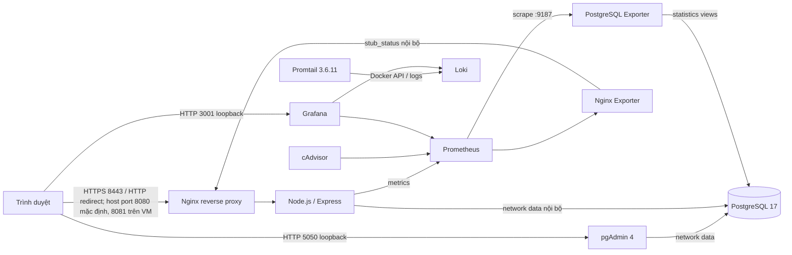

# BÁO CÁO TRIỂN KHAI

## Trang bìa

**Trường:** ..............................................................................

**Khoa:** ................................................................................

**Đề tài:** Quản lý chi tiêu cá nhân

**Sinh viên:** ..........................................................................

**Mã số sinh viên:** .................................................................

**Lớp/Khóa:** ..........................................................................
**Năm học:** ...........................................................................

> Báo cáo được chuẩn bị theo repository hiện có. Không tìm thấy rubric, đề bài dạng file hoặc báo cáo mẫu trong repository tại thời điểm kiểm tra; nội dung nào chưa chạy thực tế đều được đánh dấu `[CẦN KIỂM CHỨNG]`.

## Chương 1. Tổng quan kiến trúc hệ thống

### 1.1. Mục tiêu và thành phần

Ứng dụng cung cấp đăng ký/đăng nhập, quản lý thu nhập và chi tiêu, quản lý danh mục, lọc theo tháng và tổng quan tài chính bằng giao diện tiếng Việt. Mỗi tài khoản chỉ truy cập dữ liệu có `user_id` khớp với phiên đăng nhập.



Compose tạo các network riêng: `edge` dạng bridge cho Nginx, pgAdmin và Grafana; `data` cho PostgreSQL, ứng dụng, pgAdmin và PostgreSQL Exporter; `proxy` cho Nginx/ứng dụng/Nginx Exporter; `metrics` nội bộ cho ứng dụng, hai exporter, cAdvisor, Prometheus và Grafana; `logs` nội bộ cho Promtail, Loki và Grafana. PostgreSQL, Prometheus và các exporter không publish cổng host. Các giao diện web demo bind vào loopback; Grafana dùng `127.0.0.1:3001 -> 3000`.

### 1.2. Quản lý mã nguồn

Trước cập nhật báo cáo, nhánh là `feature/expense-tracker-full-stack` và `HEAD` là `b79736758d87283934222edd4a01e76904268d42`. Worktree đã có các thay đổi ứng dụng/hạ tầng chưa commit có chủ đích và được giữ nguyên. Ref remote không được fetch trong lượt cập nhật này. Bản báo cáo này ghi thêm kết quả nghiệm thu thủ công do Owner cung cấp; không thay đổi source/hạ tầng, không kết nối hoặc triển khai lên VM. Không tạo commit, push, PR hoặc merge.

**[CẦN KIỂM CHỨNG]** Hình minh chứng 1: chụp màn hình `git status --short --branch`, nhánh và lịch sử sau khi hoàn tất nghiệm thu. Bước chụp: chạy các lệnh Git ở cuối báo cáo trong thư mục repository.

### 1.3. Chia phần Người 1 và Người 2

- Người 1: `package.json`, `src/`, `public/`, `test/`.
- Người 2: `Dockerfile`, `.dockerignore`, `.env.example`, `.gitignore`, toàn bộ `infra/`.
- Tài liệu phối hợp: `README.md` và báo cáo này.

`infra/compose.yaml` dùng build context `..`, nên có thể chạy Compose từ repository hiện tại và build mã ứng dụng ở thư mục gốc. Chưa có file nào được chuyển sang repository nhóm.

## Chương 2. Triển khai ứng dụng, CSDL, Nginx và HTTPS

### 2.1. Công nghệ và phiên bản

| Thành phần | Phiên bản/cách dùng |
|---|---|
| Node.js | 24.21.0 trong Dockerfile; nhánh 24 LTS |
| Express | 5.1.0 |
| PostgreSQL | image `postgres:17.11-alpine` |
| pgAdmin | image `dpage/pgadmin4:9.18` |
| Nginx | image `nginx:1.30.6-alpine` |
| PostgreSQL Exporter | image `quay.io/prometheuscommunity/postgres-exporter:v0.20.1` |
| Phiên cookie | express-session, lưu trong PostgreSQL qua connect-pg-simple |
| Mật khẩu | bcryptjs 3.0.2, cost 12 |
| Metrics ứng dụng | `@prometheus-io/client` 0.16.0 |

**[CẦN KIỂM CHỨNG]** Phiên bản image/runtime chưa được agent kiểm tra độc lập bằng Docker trong môi trường Windows. Sau khi có Docker, có thể kiểm tra bằng `docker compose ... exec app node --version` và `docker compose ... exec db sh -lc 'psql -U "$POSTGRES_USER" -d "$POSTGRES_DB" -c "SELECT version();"'`. Bằng chứng Owner về runtime Grafana/ứng dụng được ghi riêng tại mục 4.2.

### 2.2. Ứng dụng và cơ sở dữ liệu

Schema ở `src/db/schema.sql` định nghĩa `users`, `categories`, `transactions` với UUID, khóa ngoại, unique/check constraints và index cho email, danh mục, chủ sở hữu và ngày giao dịch. Khóa ngoại ghép `(category_id, user_id, type)` bảo đảm giao dịch chỉ gắn với danh mục cùng chủ sở hữu và cùng loại.

API giao dịch/danh mục dùng câu lệnh tham số. Các thao tác sửa/xóa theo ID lọc đồng thời bằng `user_id` của session. Session ID được thay sau đăng nhập/đăng ký; cookie `HttpOnly`, `SameSite=Strict`, `Secure` trong Compose. Request thay đổi dữ liệu phải có CSRF token và cùng Origin. Login bị giới hạn 10 lần/15 phút/IP; đăng ký 5 lần/giờ/IP.

#### Nghiệm thu thủ công do Owner cung cấp (minh chứng ứng dụng 2–3)

- Ảnh/kết quả Owner cung cấp cho thấy tổng thu `100.000đ`, tổng chi `20.000đ`, số dư `80.000đ`; giao dịch chi “Giải trí” `20.000đ` xuất hiện trong danh sách và khoản thu “Thưởng” `100.000đ` vẫn còn.
- Owner đã thêm và sửa giao dịch. Khi sửa giao dịch chi thành `30.000đ`, tổng chi hiển thị `30.000đ` và số dư `70.000đ`; sau khi sửa lại thành `20.000đ`, tổng chi trở về `20.000đ` và số dư `80.000đ`.
- Owner tải lại trang và đăng xuất/đăng nhập lại; giao dịch cùng số liệu vẫn còn.
- Bằng chứng xác nhận các luồng xem, thêm, sửa và lưu bền qua tải lại/đăng nhập lại. Chưa có bằng chứng thao tác xóa, CRUD danh mục, kiểm thử cô lập dữ liệu giữa hai tài khoản hoặc toàn bộ kiểm thử tích hợp. Ảnh không được tạo giả; file ảnh chưa được nhúng vào repository/báo cáo.

### 2.3. Docker Compose và lưu trữ

Stack mặc định chạy ứng dụng, PostgreSQL, pgAdmin, Nginx, Prometheus, Grafana, Loki, Promtail, PostgreSQL Exporter, Nginx Exporter và cAdvisor. PostgreSQL chỉ ở network `data` nội bộ, không khai báo `ports`. pgAdmin publish `127.0.0.1:5050:80` và tham gia `data` cùng `edge`; Grafana publish `127.0.0.1:3001:3000` và tham gia `metrics`, `logs` cùng `edge` để vừa truy cập được Prometheus/Loki vừa publish giao diện qua loopback. PostgreSQL Exporter nối vào `data` để đọc metrics và `metrics` để Prometheus scrape `postgres-exporter:9187`; exporter không publish cổng host. `postgres_data`, `pgadmin_data`, `prometheus_data`, `grafana_data`, `loki_data`, `promtail_positions`, `alloy_data` và `nginx_certs` là named volume; trạng thái positions giúp Promtail tiếp tục đọc sau khi restart. Service Alloy được giữ dưới profile `legacy-alloy`, không hoạt động mặc định; chỉ dùng lệnh `stop` trên container cũ, tuyệt đối không chạy profile đó cùng Promtail. `docker compose down` không xóa volume; không dùng `down -v` khi muốn giữ dữ liệu.

pgAdmin đăng nhập bằng `PGADMIN_DEFAULT_EMAIL`/`PGADMIN_DEFAULT_PASSWORD`. Khi đăng ký server, đặt host `db`, port `5432`, maintenance database `DB_NAME`, username `DB_USER` và password `DB_PASSWORD`. Các biến này đều lấy từ `.env`; không lưu secret trong repository.

PostgreSQL Exporter `v0.20.1` được kiểm thử chính thức với PostgreSQL 13–18. Job `postgres-exporter-init` dùng tài khoản quản trị hiện có để tạo hoặc cập nhật role riêng `POSTGRES_EXPORTER_USER`, đặt role `NOSUPERUSER NOCREATEDB NOCREATEROLE NOREPLICATION NOBYPASSRLS`, cấp `CONNECT` trên database cấu hình và role dựng sẵn `pg_monitor`. Nó chỉ thay đổi metadata role/quyền, không chạy migration và không sửa schema, bảng hay dữ liệu. Exporter nhận riêng `POSTGRES_EXPORTER_USER`/`POSTGRES_EXPORTER_PASSWORD`. Tài khoản quản trị DB chỉ có trong init container; người có quyền `docker inspect` có thể xem environment. Role metrics được đặt lại theo password từ `.env` mỗi khi init job chạy; tên role phải dành riêng cho exporter.

Ứng dụng chạy bằng user `node` (UID không phải root). PostgreSQL có healthcheck `pg_isready`; app healthcheck gọi `/health/ready`, Nginx gọi endpoint readiness qua HTTPS nội bộ, Grafana có healthcheck HTTP. Loki không khai báo healthcheck vì image không có `/bin/sh`; readiness Loki được kiểm tra riêng qua `/ready` bằng container curl trên network `logs`.

### 2.4. Reverse proxy và HTTPS

Nginx nhận HTTP trong container ở cổng 80; host port cấu hình bằng `NGINX_HTTP_PORT`, mặc định `8080`, đặt `8081` trên VM hiện có vì cổng 8080 đang được dùng. HTTP chuyển hướng cùng hostname tới HTTPS cổng 8443 rồi proxy tới Express. `cert-init` tạo RSA self-signed cert cho `localhost`/`127.0.0.1` lần đầu trong named volume. TLS chỉ dành cho demo, trình duyệt sẽ cảnh báo chứng chỉ chưa được tin cậy.

Nginx và Helmet đặt `X-Frame-Options: SAMEORIGIN`, `X-Content-Type-Options: nosniff`, CSP và Referrer-Policy. Không thêm `X-XSS-Protection` vì đây là header legacy và không thay thế CSP. `/metrics` và các đường dẫn `/health/` khác bị chặn; ngoại lệ chính xác `/health/ready` chỉ cho client loopback `127.0.0.1` rồi proxy tới app để Nginx healthcheck hoạt động. Nginx `stub_status` chỉ nghe cổng nội bộ 8081.

Owner cung cấp kết quả kiểm tra thủ công: HTTP qua Nginx trả `308` chuyển hướng sang HTTPS; HTTPS trả `HTTP/2 200` khi kiểm tra bằng `curl -k`. Security headers được trả về. Output cũng có một số header trùng lặp; đây là quan sát, chưa có bằng chứng đã được sửa. Do dùng `curl -k`, kết quả không xác nhận chứng chỉ self-signed được hệ điều hành/trình duyệt tin cậy; truy cập từ Internet công cộng cũng chưa được kiểm tra.

**[CẦN KIỂM CHỨNG]** Hình minh chứng 4: bổ sung ảnh/response headers thể hiện kết quả Owner cung cấp ở trên. Các lệnh tái hiện trên Windows demo local (PowerShell):

```powershell
curl.exe -I http://localhost:8080
curl.exe -k -I https://localhost:8443
```

Trên Ubuntu VM hiện có (Linux shell), dùng HTTP `8081`:

```bash
curl -I http://127.0.0.1:8081
curl -k -I https://127.0.0.1:8443
```

Các lệnh trên chỉ là hướng dẫn tái hiện; agent không chạy chúng trong lượt cập nhật này. Ảnh minh chứng chưa được nhúng vào báo cáo.

### 2.5. pgAdmin

pgAdmin 4 `9.18` chạy trên image `dpage/pgadmin4:9.18`, publish cổng `5050` chỉ trên `127.0.0.1` và lưu cấu hình vào named volume `pgadmin_data`. Container tham gia network `data` để nối PostgreSQL và `edge` để publish giao diện; PostgreSQL không publish cổng host. Đăng nhập giao diện bằng `PGADMIN_DEFAULT_EMAIL`/`PGADMIN_DEFAULT_PASSWORD`; sau đó thêm server với host `db`, port `5432`, maintenance database `DB_NAME`, username `DB_USER` và password `DB_PASSWORD`. pgAdmin 9.18 hỗ trợ PostgreSQL 17 theo tài liệu container chính thức.

Trên Ubuntu VM, giao diện pgAdmin được mở từ Windows qua SSH local forwarding tới `127.0.0.1:5050`; không cần publish pgAdmin ra interface mạng của VM. Từ PowerShell trên Windows, lệnh dự kiến là:

```powershell
ssh -N -L 5050:127.0.0.1:5050 your-vm-user@your-vm-host
```

Giữ phiên SSH mở rồi truy cập `http://localhost:5050` trên Windows. Nếu cổng 5050 ở máy Windows bận, có thể đổi cổng local, ví dụ `ssh -N -L 15050:127.0.0.1:5050 your-vm-user@your-vm-host` và mở `http://localhost:15050`. Trong pgAdmin, PostgreSQL vẫn được đăng ký bằng host `db:5432`; SSH tunnel chỉ chuyển tiếp giao diện web.

Owner đã xác nhận trong lần kiểm tra runtime trước đó rằng endpoint pgAdmin trả HTTP 302 và cổng `5050` chỉ bind loopback. Điều này xác nhận endpoint phản hồi, không tự xác nhận đăng nhập thành công hay kết nối tới database.

**[CẦN KIỂM CHỨNG]** Hình minh chứng 7: pgAdmin qua SSH tunnel, đăng nhập thành công, server `db:5432` connected và database ứng dụng hiển thị. Chưa có bằng chứng cho các bước đăng nhập/kết nối DB trong thông tin nghiệm thu hiện tại; chỉ chụp sau khi Owner kiểm tra.

## Chương 3. Prometheus, Grafana, Loki/Promtail và LogQL

### 3.1. Thu thập metrics

Job init PostgreSQL Exporter chạy sau healthcheck DB, tạo role metrics tối thiểu và kết thúc thành công trước khi exporter khởi động. Prometheus scrape ứng dụng (`/metrics`), Nginx Exporter (`stub_status`), PostgreSQL Exporter (`postgres-exporter:9187`), cAdvisor và chính Prometheus mỗi 15 giây. Dashboard provisioned có panel `pg_up`, transaction commit/rollback mỗi giây, deadlocks mỗi phút và kích thước database, cùng request rate, HTTP p95, trạng thái target, CPU, RAM và Network I/O của container. Các metric PostgreSQL đến từ statistics views của chính PostgreSQL; datasource Prometheus và dashboard Grafana được provision từ file trong `infra/grafana/`.

Image đã pin trong Compose: Prometheus 3.14.0, Grafana 13.2.2, Loki 3.6.11, Promtail 3.6.11, PostgreSQL Exporter 0.20.1, pgAdmin 9.18, Nginx Exporter 1.4.2, cAdvisor 0.60.6. Loki dùng filesystem TSDB local, retention 7 ngày và volume riêng. Loki và Promtail dùng tag cùng phiên bản 3.6.11 từ release/image do Grafana phát hành; cấu hình Promtail được viết theo reference gắn với tag Loki 3.6.11. Đây là pin phục vụ demo, không thay đổi tình trạng hỗ trợ của Promtail. PostgreSQL Exporter công bố CI cho PostgreSQL 17; pgAdmin 9.18 hỗ trợ PostgreSQL 17. Tham chiếu: [Exporter release v0.20.1](https://github.com/prometheus-community/postgres_exporter/releases/tag/v0.20.1), [Exporter Docker image/flags](https://github.com/prometheus-community/postgres_exporter/blob/master/docs/docker.md), [Exporter quyền database](https://github.com/prometheus-community/postgres_exporter/blob/master/docs/database-permissions.md), [pgAdmin container deployment 9.18](https://www.pgadmin.org/docs/pgadmin4/9.18/container_deployment.html).

Owner đã xác nhận ở lần kiểm tra runtime trước đó rằng `up{job="postgres"}` và `pg_up` trả `1`; đây là bằng chứng do Owner cung cấp, không được chạy lại trong lượt cập nhật báo cáo này. Query transaction bên dưới và việc kiểm tra chuỗi dữ liệu theo thời gian vẫn chưa có bằng chứng.

**[CẦN KIỂM CHỨNG]** Chạy `sum by (datname) (rate(pg_stat_database_xact_commit[5m]))` để xác nhận chuỗi transaction thực tế. PostgreSQL không publish port; Prometheus UI không được mở ra host.

**[CẦN KIỂM CHỨNG]** Hình minh chứng 8: Grafana Explore cho thấy query commit/rollback và deadlocks có series với nhãn `datname`; dashboard hiển thị các panel PostgreSQL có dữ liệu. Owner đã xác nhận riêng `up{job="postgres"}=1` và `pg_up=1` ở lần kiểm tra trước, nhưng chưa cung cấp bằng chứng cho các query/panel PostgreSQL này.

### 3.2. Thu thập log và vòng đời Promtail

Không tìm thấy rubric gốc hoặc đề bài dạng file trong repository. Vì mẫu báo cáo yêu cầu Loki + Promtail, stack mặc định dùng `grafana/loki:3.6.11` và `grafana/promtail:3.6.11`. Grafana công bố Promtail EOL từ 02/03/2026, không còn hỗ trợ hay cập nhật; chỉ dùng để hoàn thành demo học tập theo mẫu, không phải lựa chọn được hỗ trợ hoặc khuyến nghị cho production. Nếu rubric bên ngoài repository chỉ định Alloy, cần đối chiếu yêu cầu đó trước khi nghiệm thu.

Tham chiếu đã tra cứu: [Loki v3.6.11 release](https://github.com/grafana/loki/releases/tag/v3.6.11), [Promtail image tags do Grafana Labs phát hành](https://hub.docker.com/r/grafana/promtail/tags), [Promtail config reference ở tag v3.6.11](https://github.com/grafana/loki/blob/v3.6.11/docs/sources/send-data/promtail/configuration.md) và [thông báo EOL chính thức](https://grafana.com/docs/loki/latest/send-data/promtail/).

Promtail dùng `docker_sd_configs` với Docker socket `/var/run/docker.sock`, discovery refresh 10 giây, lọc project `${PROMTAIL_COMPOSE_PROJECT}` và các service `app`, `nginx`, `db`. Compose bật `-config.expand-env=true` để Promtail thay biến bằng giá trị truyền qua environment; giá trị mặc định `chi-tieu-ca-nhan` khớp `name:` trong Compose. Docker service discovery yêu cầu container dùng logging driver `json-file` hoặc `journald`; cấu hình Compose hiện không thay logging driver mặc định. Promtail gắn nhãn ổn định `job="docker"`, `compose_service` (ba giá trị cố định `app`, `nginx`, `db`) và `level` chỉ cho log JSON của ứng dụng (hiện `info`/`error`). Không đưa log content, request ID, container ID hoặc đường dẫn động vào label. Pipeline duy nhất chạy mặc định là Promtail; Alloy config cũ được giữ trong `infra/alloy/config.alloy`, còn service Alloy chỉ nằm trong profile `legacy-alloy` để có thể dừng container cũ mà không xóa volume. Không chạy lệnh `up` với profile này. Tham chiếu env expansion: [Grafana Loki configuration parameters](https://grafana.com/docs/loki/latest/configure/).

Owner xác nhận bản VM hiện chạy project `expense-tracker-demo` và Promtail của VM đã được chỉnh để lọc tên đó. Owner cũng từng xác nhận các biến môi trường bổ sung cho pgAdmin, PostgreSQL Exporter, HTTP port và project label đã được thêm vào `.env` hiện có; báo cáo không chứa giá trị của chúng. Khi cập nhật VM sau này, giữ nguyên project identity bằng `docker compose --project-name expense-tracker-demo ...`; không đổi `name:` trong repository hoặc project name trên VM một cách độc lập vì Compose dùng project name làm prefix cho named volume và có thể khởi tạo volume DB khác. Không đọc hay sao chép `.env` VM trong lượt cập nhật báo cáo này.

Luồng log: stdout/stderr của app và Nginx (cùng db để hỗ trợ debug) → Docker API qua socket → Promtail → `http://loki:3100/loki/api/v1/push` qua network `logs` nội bộ → Grafana datasource Loki. Socket được bind `:ro`, nhưng chế độ mount chỉ đọc không giới hạn các API call gửi qua socket; quyền này nhạy cảm trên Docker host. Cấu hình dùng Linux containers và không bind mount đường dẫn log của host, để giảm phụ thuộc đường dẫn trên Docker Desktop; khả năng socket hoạt động trên Windows Docker Desktop vẫn cần runtime xác nhận.

Loki không có shell trong image nên healthcheck `CMD-SHELL` không dùng được. Cấu hình nguồn bỏ healthcheck đó; Promtail chỉ phụ thuộc `loki: service_started`, điều này không khẳng định Loki đã sẵn sàng. Có thể kiểm tra `/ready` riêng từ một container curl tham gia network `logs`. Với project VM hiện có, lệnh Linux là `docker run --rm --network expense-tracker-demo_logs curlimages/curl:8.12.1 --fail --show-error http://loki:3100/ready`. Image curl được pin ở tag `8.12.1` ([repository chính thức curl-container](https://github.com/curl/curl-container)). Theo kết quả Owner cung cấp, Loki `/ready` đã trả `HTTP/1.1 200 OK` với body `ready` tại thời điểm kiểm tra; agent không chạy lại lệnh này trong lượt cập nhật báo cáo.

Owner đã cung cấp bằng chứng nghiệm thu thủ công: Grafana container healthy; Docker publish `127.0.0.1:3001 -> 3000`; `http://127.0.0.1:3001/api/health` trả HTTP 200. Ảnh dashboard cho thấy các panel request rate, HTTP p95 latency, scrape target, CPU, RAM và log có dữ liệu tại thời điểm chụp. Bằng chứng xác nhận giao diện/dashboard hiển thị các panel đó lúc kiểm tra, không xác nhận mọi target đều healthy sau lần triển khai cuối hoặc khả năng truy cập từ Internet công cộng. Ảnh do Owner cung cấp chưa được nhúng vào repository/báo cáo.

### 3.3. Truy vấn LogQL mẫu

Các truy vấn dưới đây khớp với selector/labels và format log của cấu hình Promtail. Ảnh Owner cung cấp cho thấy panel log trong dashboard có dữ liệu, nhưng ba truy vấn LogQL cụ thể này chưa được xác nhận chạy trên Loki. Cần mở Grafana Explore, chọn datasource Loki, đặt thời gian `Last 15 minutes`, chạy lần lượt và kiểm tra stream labels trước khi ghi kết quả truy vấn.

```logql
# [CẦN KIỂM CHỨNG] Log truy cập Nginx có status HTTP 5xx
{job="docker", compose_service="nginx"} |~ " 5[0-9][0-9] "

# [CẦN KIỂM CHỨNG] Lỗi ứng dụng theo label level được trích từ JSON
{job="docker", compose_service="app", level="error"}

# [CẦN KIỂM CHỨNG] Số log theo service trong 5 phút
sum by (compose_service) (count_over_time({job="docker"}[5m]))
```

## Chương 4. Hardening, đánh giá bảo mật và kết luận

### 4.1. Hardening đã cấu hình

- Không có vai trò admin trong ứng dụng; Grafana admin riêng cho công cụ monitoring.
- Mật khẩu băm bcrypt; session lưu phía server trong PostgreSQL, ID rotate sau đăng nhập/đăng ký.
- CSRF token ngẫu nhiên, kiểm tra Origin, cookie `HttpOnly`/`SameSite=Strict`/`Secure` khi chạy Compose.
- SQL dùng bind parameters; validation có giới hạn độ dài, kiểu, ngày lịch và số tiền.
- Mọi truy vấn theo ID đều kiểm tra `user_id`; FK ghép chống gắn chéo chủ sở hữu.
- Nginx ẩn version, giới hạn body, CSP và security headers; cổng DB không publish ra host.
- pgAdmin chỉ bind vào `127.0.0.1:5050`; PostgreSQL Exporter chỉ nghe trên các network nội bộ và không publish port.
- Secret được đọc từ `.env`; `.gitignore` bỏ qua `.env` và cho phép giữ `.env.example` không chứa secret thật.

### 4.2. Giới hạn và rủi ro cần nghiệm thu

- Self-signed HTTPS và cổng bind loopback chỉ phù hợp demo/local, không phải triển khai Internet.
- cAdvisor dùng `privileged` và đọc các mount hệ thống để có số liệu container. Promtail cần Docker socket để discovery và đọc stream log; mount `:ro` không hạn chế quyền của Docker API. Chỉ chạy trong môi trường demo tin cậy và không mở endpoint agent ra host.
- Init job cần `DB_USER`/`DB_PASSWORD` superuser hiện có để provision role metrics. Người có quyền đọc environment của Docker container có thể xem credential đó. Exporter chạy sau đó bằng role riêng `pg_monitor` không phải superuser. Owner từng xác nhận exporter có metrics và target Prometheus hoạt động; quyền cụ thể của role/init SQL chưa được agent kiểm tra độc lập trong lượt cập nhật báo cáo này.

#### Bằng chứng runtime và nghiệm thu thủ công do Owner cung cấp

- Theo snapshot `docker compose ... ps -a` Owner cung cấp tại thời điểm kiểm tra: `app`, `db`, `nginx`, `grafana`, `promtail`, `cadvisor` ở trạng thái Up và healthy; `loki`, `prometheus`, `nginx-exporter`, `pgadmin`, `postgres-exporter` ở trạng thái Up. `cert-init` và `postgres-exporter-init` đã Exited (0), là các job chạy một lần. Snapshot này chỉ mô tả thời điểm kiểm tra, không chứng minh trạng thái liên tục sau đó.
- Snapshot port do Owner cung cấp: Grafana `127.0.0.1:3001 -> 3000`; Nginx `127.0.0.1:8081 -> 80` và `127.0.0.1:8443 -> 443`; pgAdmin `127.0.0.1:5050 -> 80`. Các mapping được báo cáo đều bind loopback.
- Owner báo HTTP qua Nginx trả `308` tới HTTPS; HTTPS trả `HTTP/2 200` khi dùng `curl -k`, và security headers được trả. Có một số header trùng lặp; chưa có bằng chứng đã sửa. Do dùng `curl -k`, chứng chỉ self-signed chưa được xác nhận là trusted.
- Owner cung cấp kết quả Loki `/ready` là `HTTP/1.1 200 OK`, body `ready`, tại thời điểm kiểm tra. Trước đó Loki từng trả `503`; kết quả mới xác nhận readiness ở lần kiểm tra này nhưng không chứng minh trạng thái liên tục.
- Grafana healthy; Docker publish `127.0.0.1:3001 -> 3000`; `/api/health` trả HTTP 200. Ảnh dashboard Owner cung cấp cho thấy request rate, HTTP p95 latency, scrape targets, CPU, RAM và logs có dữ liệu tại thời điểm chụp. Ảnh chưa được nhúng vào repository/báo cáo.
- Ở lần kiểm tra trước, Owner xác nhận PostgreSQL Exporter có `pg_up=1`, target Prometheus `postgres` trả `1`; pgAdmin trả HTTP 302 và chỉ bind loopback `127.0.0.1:5050`. Điều này không xác nhận đăng nhập pgAdmin hoặc kết nối server DB trong giao diện.
- Owner xác nhận ứng dụng hiển thị tổng thu `100.000đ`, tổng chi `20.000đ`, số dư `80.000đ`; giao dịch “Giải trí” `20.000đ` và khoản thu “Thưởng” `100.000đ` còn trong danh sách. Khi sửa khoản chi thành `30.000đ`, tổng chi/số dư đổi thành `30.000đ`/`70.000đ`; sửa về `20.000đ` thì số liệu trở lại `20.000đ`/`80.000đ`. Tải lại trang và đăng xuất/đăng nhập lại không làm mất giao dịch.
- Owner trước đây xác nhận sau khi restart riêng DB, ứng dụng vẫn healthy, giao dịch thử `100.000 ₫` còn nguyên và PostgreSQL dùng volume `expense-tracker-demo_postgres_data`.

Đây là kết quả runtime/thao tác thủ công theo ảnh, output và thông tin Owner cung cấp; agent không truy cập VM hoặc tự lặp lại các thao tác trong lượt cập nhật tài liệu. Ảnh minh chứng được Owner cung cấp chưa được nhúng vào repository/báo cáo.

#### Các mục vẫn chưa được xác minh

- Loki từng được Owner báo trả 503; lần kiểm tra Owner mới nhất cho thấy `/ready` trả 200 với body `ready`. Đây là kết quả tại thời điểm kiểm tra, không phải cam kết readiness liên tục. API labels trước đó trả trạng thái `success` theo kết quả Owner cung cấp, nhưng API query và ba truy vấn LogQL mẫu chưa được kiểm chứng trong Explore. Panel log có dữ liệu tại thời điểm ảnh chụp không thay thế việc xác nhận từng truy vấn LogQL.
- Các query transaction, deadlock và panel PostgreSQL trong dashboard chưa được Owner xác nhận bằng ảnh/kết quả. Chỉ `up{job="postgres"}` và `pg_up` được xác nhận ở lần kiểm tra trước.
- Snapshot Owner cung cấp ghi nhận các trạng thái service tại một thời điểm; chưa có bằng chứng về trạng thái liên tục sau đó. Chưa kiểm tra cổng từ Internet công cộng, xóa giao dịch/danh mục, toàn bộ luồng CRUD hoặc cô lập dữ liệu giữa nhiều tài khoản.
- HTTPS dùng chứng chỉ self-signed chỉ phù hợp demo/local. `curl -k` bỏ qua xác thực chứng chỉ nên chưa chứng minh chứng chỉ CA tin cậy; truy cập Internet công cộng cũng chưa được kiểm tra.
- Promtail đã EOL từ 02/03/2026; được giữ riêng cho demo học tập do không tìm thấy rubric và mẫu báo cáo có Promtail. Không triển khai Promtail này cho production; Alloy là cấu hình lưu trữ nhưng không hoạt động trong stack mặc định.
- Docker CLI không có trong PATH của máy Windows này; lượt cập nhật báo cáo không chạy Compose, không kết nối VM và không tự kiểm tra runtime. Header trùng lặp đã được quan sát nhưng chưa sửa; provisioning, Docker socket trên Docker Desktop, truy vấn LogQL cụ thể và panel/query PostgreSQL chi tiết vẫn cần nghiệm thu riêng theo mục tương ứng.
- Test HTTP dùng PostgreSQL pool giả; cần chạy thêm tích hợp với PostgreSQL thật để xác nhận schema, session store, cascade/restrict và truy vấn tổng hợp.

### 4.3. Kết luận và hướng phát triển

Mã nguồn ứng dụng và cấu hình hạ tầng đã được tổ chức trong repository cá nhân, có ranh giới rõ giữa `src/`/`public/` và `infra/`. Sau khi chạy kiểm thử Docker, hướng tiếp theo là thay chứng chỉ bằng CA/TLS thật nếu triển khai, quản lý secret ngoài file `.env`, sao lưu/khôi phục volume có quy trình, thêm kiểm thử tích hợp PostgreSQL và cập nhật monitoring theo rubric chính thức.

### 4.4. Kiểm tra tự động, runtime và thủ công

#### Kiểm tra tự động/cục bộ đã chạy ở các lượt trước

- `npm run lint`: thành công; `node --check` cho server, validation, giao diện và test.
- `npm test`: 2 test đạt, 0 thất bại. Test dùng PostgreSQL pool/session store giả; không xác nhận tích hợp PostgreSQL thật.
- `npm audit --omit=dev --audit-level=high`: `found 0 vulnerabilities`.
- Python PyYAML parse các YAML và assertion cấu hình Compose, pgAdmin, exporter, project label, target/dashboard tĩnh đã đạt ở các lượt trước. Các kết quả đó không xác nhận runtime.
- Lượt này chỉ sửa báo cáo; chưa chạy test ứng dụng hay Compose. `git diff --check` và kiểm tra whitespace của báo cáo được chạy sau khi cập nhật.

#### Runtime/thao tác thủ công

Kết quả Owner cung cấp được ghi riêng ở mục 4.2 và mục 2.2/2.4/3.2. Không có kiểm tra runtime độc lập từ agent trong lượt cập nhật tài liệu này.

#### Git và trạng thái môi trường

Ở đầu lượt cập nhật, nhánh `feature/expense-tracker-full-stack`, `HEAD` `b79736758d87283934222edd4a01e76904268d42`; worktree đã có thay đổi có chủ đích và được giữ nguyên. Không fetch remote, kết nối VM, đọc/ghi `.env`, chạy Docker Compose, hoặc commit/push/PR/merge.

### 4.5. Lệnh nghiệm thu

#### Windows Docker Desktop — stack demo local mới (PowerShell)

Chỉ dùng `Copy-Item` khi tạo stack local mới trên Windows. Không dùng lệnh này cho VM đã có `.env` và dữ liệu:

```powershell
Copy-Item .env.example .env
# Thay các placeholder trong .env bằng secret riêng trước khi chạy.
docker compose --env-file .env -f infra/compose.yaml config --quiet
# Chỉ khi có Alloy cũ đang chạy trong project local này; không xóa volume.
docker compose --env-file .env -f infra/compose.yaml --profile legacy-alloy stop alloy
docker compose --env-file .env -f infra/compose.yaml up --build -d
docker compose --env-file .env -f infra/compose.yaml ps
docker compose --env-file .env -f infra/compose.yaml logs --tail 100 app nginx db pgadmin postgres-exporter-init postgres-exporter prometheus grafana loki promtail cadvisor
```

Lệnh `stop alloy` chỉ cần khi có container Alloy từ cấu hình trước; giữ nguyên named volumes. Không chạy `up` với profile `legacy-alloy` cùng Promtail và không dùng `down -v` khi cần giữ dữ liệu.

#### Ubuntu VM hiện có — cập nhật tương lai, chưa chạy

Không sao chép `.env.example` lên `.env` và không ghi đè file hiện có. Owner từng xác nhận đã bổ sung các biến `PGADMIN_DEFAULT_EMAIL`, `PGADMIN_DEFAULT_PASSWORD`, `POSTGRES_EXPORTER_USER`, `POSTGRES_EXPORTER_PASSWORD`, `NGINX_HTTP_PORT=8081` và `PROMTAIL_COMPOSE_PROJECT=expense-tracker-demo`; trước lần cập nhật tiếp theo, xác nhận cấu hình hiện có theo quy trình bảo vệ secret và chỉ thay đổi biến cần thiết. Dùng project identity `expense-tracker-demo` trong mọi lệnh Compose để giữ nguyên prefix volume; không chạy `down -v`.

Các lệnh sau là Linux shell trên VM tại `~/expense-tracker-deploy`. Chúng chỉ là hướng dẫn, chưa được thực hiện trong lượt này:

```bash
cd ~/expense-tracker-deploy
docker compose --project-name expense-tracker-demo --env-file .env -f infra/compose.yaml config --quiet
docker compose --project-name expense-tracker-demo --env-file .env -f infra/compose.yaml up --build -d
docker compose --project-name expense-tracker-demo --env-file .env -f infra/compose.yaml ps
docker compose --project-name expense-tracker-demo --env-file .env -f infra/compose.yaml logs --tail 100 app nginx db pgadmin postgres-exporter-init postgres-exporter prometheus grafana loki promtail
```

Loki không có `/bin/sh`; kiểm tra readiness riêng bằng container curl trên network project `logs`, không dùng healthcheck shell hoặc `docker compose exec loki sh`:

```bash
docker run --rm --network expense-tracker-demo_logs curlimages/curl:8.12.1 --fail --show-error http://loki:3100/ready
```

Owner đã xác nhận trước đó `up{job="postgres"}=1` và `pg_up=1`; ảnh dashboard cho thấy panel log có dữ liệu; kết quả Owner mới nhất cho biết Loki `/ready` trả `200` và body `ready`. Các panel/query PostgreSQL chi tiết và ba truy vấn LogQL cụ thể vẫn `[CẦN KIỂM CHỨNG]`. Bằng chứng ứng dụng (mục 2–3) và dashboard tổng quan (mục 5–6) được Owner cung cấp nhưng chưa nhúng vào báo cáo; cần bổ sung ảnh minh chứng còn thiếu, gồm 1, 4, 7 và 8. Không sử dụng ảnh giả hoặc thay bằng bằng chứng từ cấu hình nguồn.
